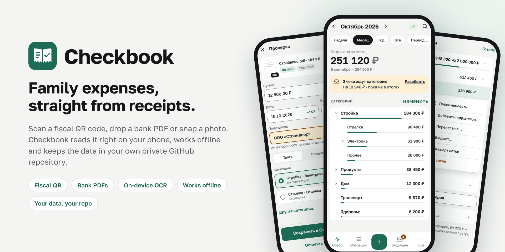
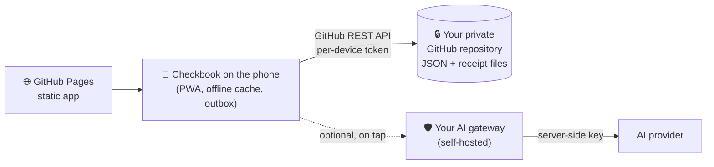

<p align="center">
  <picture>
    <source media="(prefers-color-scheme: dark)" srcset="docs/assets/hero-en-dark.png">
    
  </picture>
</p>

<p align="center">
  <b>Family expenses, straight from receipts.</b><br>
  A phone app that reads fiscal QR codes, bank PDFs and photos, works offline<br>
  and keeps every byte of your data in your own private GitHub repository.
</p>

<p align="center">
  <a href="README.ru.md">Русский</a> ·
  <a href="docs/architecture.md">How it works</a> ·
  <a href="gateway/README.md">Optional AI gateway</a> ·
  <a href="design/README.md">Design system</a>
</p>

---

## Why Checkbook

**30 seconds from receipt to category.** Point the camera at the QR code on a Russian fiscal receipt, share a bank
transfer PDF or snap a photo — Checkbook pulls out the date, time, amount and payee, suggests a category and you tap
"Save". One receipt can be split across several categories.

**Your money, your data.** There is no Checkbook server and no account with us. Operations are small JSON files in a
private GitHub repository that you own; the receipt files sit right next to them. You can read, back up or move
everything without the app.

**Made for a family.** One account owner sets things up; family members join by scanning a QR invite — they do not
need a GitHub account. Everyone sees the same category tree, and every operation shows who added it.

**Works offline.** Installed to the home screen on iPhone or Android, Checkbook keeps working in a basement or on a
plane. New operations wait in a local queue and sync as soon as the network is back.

**See where it went.** Totals for any branch of an unlimited category tree — "Renovation" = "Finishing" + "Electrics" +
"Other" — for a week, a month, a custom period or all time, with an optional budget and "spent of planned" progress.

**Private by design.** Recognition (QR, PDF text, OCR) runs on the phone. AI is off by default and works only through a
gateway you host yourself, so no AI key ever reaches a phone or this repository.

## Highlights

| | |
|---|---|
| 📷 **Fiscal QR** | instant import of receipt data from the QR code |
| 📄 **Bank PDFs** | text-layer parsing of transfer and payment receipts from popular banks |
| 🔍 **On-device OCR** | photos and screenshots are read without uploading them anywhere |
| ✨ **Optional AI** | one tap for a hard receipt, through your self-hosted gateway |
| 🌳 **Category tree** | unlimited depth, budgets, splitting one receipt into parts |
| 👨‍👩‍👧 **Family access** | QR invites, per-device keys that the owner can revoke |
| 📴 **Offline-first** | IndexedDB cache and outbox, conflict-safe sync |
| 🔒 **App lock** | Face ID / fingerprint (WebAuthn) or a PIN |
| ⬇️ **Export** | CSV and JSON at any time |
| 🌓 **Light and dark** | follows the system theme |

## How it works



The app itself is a static site on GitHub Pages. Your data never passes through it: the phone talks to GitHub directly
with its own fine-grained token that can open only your data repository. Read more in
[How it works](docs/architecture.md).

## Status

Early development: the design system, screen mock-ups, test fixtures and the AI gateway are in place; the app code is
being built step by step. Watch the repository to see the first release.

## Run your own copy

1. Fork the repository and enable **Settings → Pages → Source: GitHub Actions**, ideally with your own (sub)domain.
2. Create a private repository for the data (with a README so it has a `main` branch).
3. Open your Checkbook address on the phone, install it to the home screen and follow the setup wizard — it explains
   how to create the access token.
4. Optional: deploy the [AI gateway](gateway/README.md) and set the repository secret `CHECKBOOK_GATEWAY_ORIGIN`.

## Tech stack

Vite · TypeScript (strict) · Preact + signals · IndexedDB · Service Worker · pdf.js · Tesseract.js · zxing-wasm ·
Vitest · Playwright · GitHub Actions · Node 24 (gateway, zero dependencies).

## Repository map

| Path | What |
|---|---|
| `src/`, `public/` | the app (arrives with the first releases) |
| [`design/`](design/README.md) | design tokens, `ck-*` components, screen mock-ups (light and dark), icons, splash screens |
| [`gateway/`](gateway/README.md) | the optional AI gateway with tests and a Docker Compose example |
| [`fixtures/`](fixtures/README.md) | synthetic receipts, QR codes, PDFs and broken files for tests |
| [`tests/`](tests/device-checklists/README.md) | automated tests and manual device checklists |
| [`docs/`](docs/architecture.md) | how the app is built |

## Development

```sh
npm ci --ignore-scripts
npm test            # unit tests (Vitest)
npm run build       # production build into dist/
npm run test:e2e    # Playwright: Chromium and iPhone WebKit
```

Pull requests go into `main` and must pass the `ci` checks. Documentation is bilingual: `NAME.md` in English,
`NAME.ru.md` in Russian.
