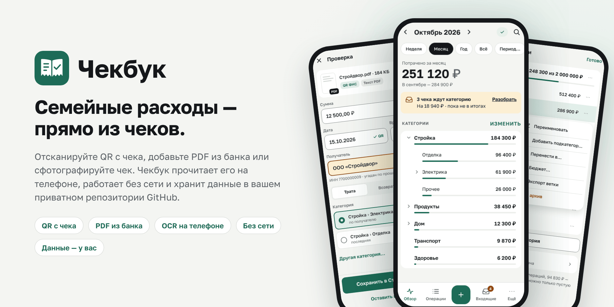
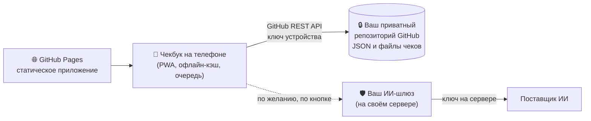

<p align="center">
  <picture>
    <source media="(prefers-color-scheme: dark)" srcset="docs/assets/hero-ru-dark.png">
    
  </picture>
</p>

<p align="center">
  <b>Семейные расходы — прямо из чеков.</b><br>
  Приложение на телефоне читает QR с кассовых чеков, PDF из банка и фотографии, работает без сети<br>
  и хранит все ваши данные в вашем собственном приватном репозитории GitHub.
</p>

<p align="center">
  <a href="README.md">English</a> ·
  <a href="docs/architecture.ru.md">Как это устроено</a> ·
  <a href="gateway/README.ru.md">ИИ-шлюз (по желанию)</a> ·
  <a href="design/README.ru.md">Дизайн-система</a>
</p>

---

## Зачем Чекбук

**30 секунд от чека до категории.** Наведите камеру на QR кассового чека, поделитесь PDF перевода из банка или
сфотографируйте чек — Чекбук сам найдёт дату, время, сумму и получателя, предложит категорию, и останется нажать
«Сохранить». Один чек можно разделить на несколько категорий.

**Ваши деньги — ваши данные.** У Чекбука нет своего сервера и нет учётной записи у нас. Операции — небольшие
JSON-файлы в приватном репозитории GitHub, который принадлежит вам; файлы чеков лежат рядом. Всё можно прочитать,
скопировать или перенести и без приложения.

**Для семьи.** Владелец учёта настраивает всё один раз; участники подключаются, отсканировав QR-приглашение, — аккаунт
GitHub им не нужен. У всех одно дерево категорий, у каждой операции видно, кто её добавил.

**Работает без сети.** Установленный на экран «Домой» iPhone или Android, Чекбук работает и в подвале, и в самолёте.
Новые операции ждут в очереди на телефоне и уходят, как только появится сеть.

**Видно, куда ушли деньги.** Итоги по любой ветке дерева категорий без ограничения глубины — «Стройка» = «Отделка» +
«Электрика» + «Прочее» — за неделю, месяц, свой период или всё время, с необязательным бюджетом и прогрессом
«потрачено из плана».

**Приватность по умолчанию.** Распознавание (QR, текст PDF, OCR) идёт на телефоне. ИИ выключен по умолчанию и работает
только через шлюз, который вы разворачиваете сами, — ключ ИИ не попадает ни на телефоны, ни в этот репозиторий.

## Возможности

| | |
|---|---|
| 📷 **QR с чека** | мгновенный импорт данных кассового чека из QR-кода |
| 📄 **PDF из банка** | разбор текста квитанций о переводах и оплатах популярных банков |
| 🔍 **OCR на телефоне** | фото и скриншоты распознаются без отправки куда-либо |
| ✨ **ИИ по желанию** | одно нажатие для трудного чека — через ваш собственный шлюз |
| 🌳 **Дерево категорий** | любая глубина, бюджеты, разделение чека на части |
| 👨‍👩‍👧 **Семейный доступ** | QR-приглашения, отдельный ключ на каждом телефоне, владелец может отозвать |
| 📴 **Сначала офлайн** | кэш и очередь отправки в IndexedDB, синхронизация без потерь |
| 🔒 **Блокировка** | Face ID / отпечаток (WebAuthn) или PIN |
| ⬇️ **Экспорт** | CSV и JSON в любой момент |
| 🌓 **Светлая и тёмная тема** | как в системе |

## Как это устроено



Само приложение — статический сайт на GitHub Pages. Ваши данные через него не идут: телефон обращается к GitHub
напрямую, со своим fine-grained ключом, который открывает только ваш репозиторий данных. Подробнее — в разделе
[Как это устроено](docs/architecture.ru.md).

## Состояние

Ранняя разработка: дизайн-система, макеты экранов, тестовые файлы и ИИ-шлюз готовы; код приложения появляется по
шагам. Нажмите Watch, чтобы не пропустить первый выпуск.

## Своя копия

1. Сделайте fork и включите **Settings → Pages → Source: GitHub Actions**, лучше со своим доменом или поддоменом.
2. Создайте приватный репозиторий для данных (с README, чтобы в нём была ветка `main`).
3. Откройте адрес своего Чекбука на телефоне, установите его на экран «Домой» и пройдите мастер настройки — он
   объяснит, как выпустить ключ доступа.
4. По желанию: разверните [ИИ-шлюз](gateway/README.ru.md) и задайте секрет репозитория `CHECKBOOK_GATEWAY_ORIGIN`.

## Технологии

Vite · TypeScript (strict) · Preact + signals · IndexedDB · Service Worker · pdf.js · Tesseract.js · zxing-wasm ·
Vitest · Playwright · GitHub Actions · Node 24 (шлюз, без зависимостей).

## Что где лежит

| Путь | Что |
|---|---|
| `src/`, `public/` | приложение (появится с первыми выпусками) |
| [`design/`](design/README.ru.md) | токены, компоненты `ck-*`, макеты экранов (светлая и тёмная тема), иконки, заставки |
| [`gateway/`](gateway/README.ru.md) | ИИ-шлюз (по желанию) с тестами и примером Docker Compose |
| [`fixtures/`](fixtures/README.ru.md) | синтетические чеки, QR-коды, PDF и «плохие» файлы для тестов |
| [`tests/`](tests/device-checklists/README.ru.md) | автотесты и ручные проверки на устройствах |
| [`docs/`](docs/architecture.ru.md) | как устроено приложение |

## Разработка

```sh
npm ci --ignore-scripts
npm test            # unit-тесты (Vitest)
npm run build       # сборка в dist/
npm run test:e2e    # Playwright: Chromium и WebKit iPhone
```

Pull request'ы идут в `main` и должны пройти проверки `ci`. Документация — на двух языках: `NAME.md` на английском,
`NAME.ru.md` на русском.
